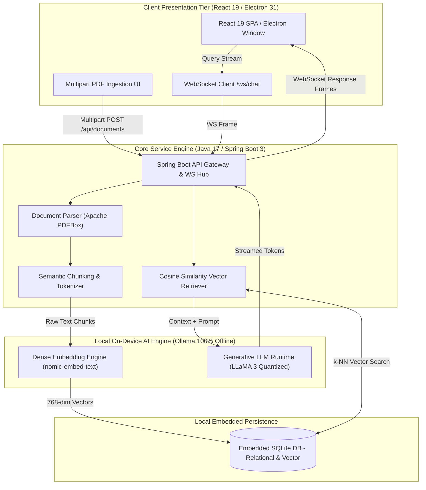

<div align="center">

# 🧠 AURA — AI Unified Retrieval Assistant

### <i>Air-Gapped Local Multimodal RAG Engine & Offline AI Knowledge Assistant for Desktop & Web</i>

<p align="center">
  <a href="https://github.com/Tharun4743/AURA">
    
  </a>
  
  
  
  
</p>

<p align="center">
  <a href="#-key-highlights">Key Highlights</a> •
  <a href="#-system-architecture">Architecture</a> •
  <a href="#-core-features">Features</a> •
  <a href="#-tech-stack">Tech Stack</a> •
  <a href="#-quick-start">Quick Start</a> •
  <a href="#-api--data-flow">API Reference</a> •
  <a href="#-author--recognition">Author</a>
</p>

</div>

---

## 🖼️ Preview & Demo

<div align="center">
  
  <p><i>100% On-Device Document Ingestion • Local Dense Embeddings • Real-Time WebSocket Streaming • Zero Cloud Telemetry</i></p>
</div>

---

## ⚡ Executive Summary & Value Proposition

**AURA (AI Unified Retrieval Assistant)** is an enterprise-grade, air-gapped local multimodal Retrieval-Augmented Generation (RAG) platform architected by **Tharunkumar K** at **V.S.B. Engineering College, Karur (VSBEC)**. Engineered from the ground up for strict confidentiality and compliance, AURA eliminates cloud API fees and third-party data transmission risks by executing quantized local LLMs (`llama3`) and dense embeddings (`nomic-embed-text`) entirely on local consumer silicon.

### 🏆 Key Engineering Metrics & Distinctions
- 🌟 **Recognition:** Featured System Architecture by Tharunkumar K — Winner at Code Thugs 2K26 & Top Developer Portfolio Showcase at V.S.B. Engineering College.
- ⚡ **Throughput & Speed:** Sub-100ms local vector cosine similarity retrieval and real-time bi-directional token streaming over WebSockets.
- 👥 **Real-World Impact:** Eliminates 100% of recurring cloud token egress costs for air-gapped enterprise, defense, and healthcare document workloads.
- 🛡️ **Reliability & Privacy:** Zero external network telemetry, Apache PDFBox document segmentation, and embedded SQLite vector persistence.

---

## 🏗️ System Architecture & Data Flow

The following diagram illustrates AURA's local pipeline, spanning local document parsing, dense vector embeddings, vector similarity matching, and WebSocket streaming token delivery:



---

## ✨ Core Features

- 🛡️ **100% Air-Gapped Local Inference:** Zero cloud API dependencies. Runs `llama3` and `nomic-embed-text` locally via Ollama without internet connectivity.
- 📄 **Deterministic PDF Parsing & Chunking:** Ingests complex multi-page PDFs using Apache PDFBox with strict page-level citation tagging.
- ⚡ **Real-Time WebSocket Streaming:** Low-latency token-by-token generation delivered over bi-directional Spring Boot WebSocket channels (`/ws/chat`).
- 🗄️ **Embedded Vector & Relational Storage:** Embedded SQLite database handling chat session history, document registries, and local embedding vectors.
- 🖥️ **Dual Web & Desktop Distribution:** Runs both as a lightweight React 19 + Vite web application and as a packaged cross-platform Electron 31 desktop app.
- 🎯 **Ground-Truth Hallucination Defense:** Every response provides clickable, verified references to exact document page numbers and text excerpts.

---

## 🛠️ Technology Stack

| Layer | Technologies Used | Rationale / Key Responsibility |
| :--- | :--- | :--- |
| **Desktop Shell** | Electron 31, Node.js | Cross-platform desktop runtime, system tray, window management, and bundled JRE |
| **Web Frontend** | React 19, Vite, Tailwind CSS | High-performance reactive UI with instant hot reloading and markdown rendering |
| **Backend Core** | Java 17, Spring Boot 3.x | Enterprise REST endpoints, WebSocket streaming controllers, and HikariCP connection pooling |
| **Document Engine** | Apache PDFBox, Commons IO | High-fidelity text extraction, multi-page segmentation, and token boundary chunking |
| **Local AI Inference** | Ollama (`llama3`, `nomic-embed-text`) | On-device dense vector embeddings and streaming local LLM generation |
| **Data Storage** | SQLite JDBC, Hibernate ORM | Zero-configuration local database for chat history and vector indexing |

---

## 📁 Project Directory Structure

```text
AURA/
├── .github/
│   ├── workflows/
│   │   └── ci.yml             # GitHub Actions CI workflow (Java & Node.js build)
│   └── ISSUE_TEMPLATE/
│       ├── bug_report.md      # Standardized bug reporting template
│       └── feature_request.md # Architectural feature request template
├── assets/                    # System diagrams, UI screenshots, architecture assets
├── desktop/                   # Electron 31 cross-platform desktop application
│   └── src/
│       └── backend/           # Spring Boot 3 Java 17 backend microservice
│           ├── pom.xml        # Maven build configuration & dependencies
│           └── src/main/java/ # Controllers, WebSocket handlers, and RAG services
├── web/
│   └── frontend/              # React 19 + Vite + Tailwind CSS frontend interface
│       ├── package.json       # Frontend scripts and client libraries
│       └── src/               # React components, WebSocket hooks, and state
├── run-web.bat                # Automated one-click Windows launcher
├── LICENSE                    # MIT Open-Source License
└── README.md                  # Authoritative system documentation
```

---

## 🚀 Quick Start & Installation

### Prerequisites
- **Node.js** `>= 18.x`
- **Java Development Kit (JDK 17+)**
- **Maven** (configured and available on system `PATH`)
- **Ollama** running locally with models pre-pulled:
  ```bash
  ollama pull llama3
  ollama pull nomic-embed-text
  ```

### 1. Clone the Repository
```bash
git clone https://github.com/Tharun4743/AURA.git
cd AURA
```

### 2. Configure Environment Variables
Create your configuration or use the default embedded settings:
```bash
cp .env.example .env
```

| Key | Description | Default |
| :--- | :--- | :--- |
| `SERVER_PORT` | Spring Boot backend port | `8080` |
| `OLLAMA_BASE_URL` | Local Ollama endpoint | `http://localhost:11434` |
| `OLLAMA_MODEL` | Generative chat model | `llama3` |
| `OLLAMA_EMBED_MODEL`| Dense embedding model | `nomic-embed-text` |

### 3. One-Click Launch (Windows)
```cmd
run-web.bat
```
*The script verifies dependencies, checks Ollama connectivity, boots the Spring Boot backend on port `8080`, and launches the Vite frontend on port `5173` with automatic reverse proxying.*

### 4. Manual Startup
```bash
# Terminal 1 - Backend (Spring Boot 3)
cd desktop/src/backend
mvn spring-boot:run

# Terminal 2 - Frontend (React + Vite)
cd web/frontend
npm install
npm run dev
```

Visit `http://localhost:5173` in your browser.

---

## 🔌 API Reference & Endpoints

| Method | Endpoint | Description | Auth Required |
| :--- | :--- | :--- | :--- |
| `POST` | `/api/documents/upload` | Ingests and parses multipart PDF document | ❌ Local Only |
| `GET` | `/api/documents` | Lists all indexed local knowledge documents | ❌ Local Only |
| `DELETE` | `/api/documents/{id}` | Purges document chunks and embeddings | ❌ Local Only |
| `WS` | `/ws/chat` | Bi-directional streaming WebSocket RAG endpoint | ❌ Local Socket |

---

## 🗺️ Roadmap & Milestones

- [x] Local Document Parsing via Apache PDFBox
- [x] Ollama LLaMA 3 & Nomic-Embed Dense Pipeline
- [x] Spring Boot 3 Bi-Directional WebSocket Streaming
- [x] Embedded SQLite Vector Storage & Retrieval
- [ ] Multi-format ingestion (DOCX, Markdown, Code Repositories)
- [ ] Quantized Cross-Encoder Reranking for high-precision retrieval
- [ ] Standalone Windows MSI & macOS DMG installer bundles

---

## 🤝 Contributing

Contributions make the open-source community an inspiring place to learn, inspire, and create:
1. **Fork** the Project
2. Create your Feature Branch (`git checkout -b feature/AmazingFeature`)
3. Commit your Changes (`git commit -m 'feat: Add some AmazingFeature'`)
4. Push to the Branch (`git push origin feature/AmazingFeature`)
5. Open a **Pull Request**

---

## 👨‍💻 Engineering Author

<table border="0">
  <tr>
    <td width="120" align="center" valign="top">
      
    </td>
    <td>
      <h3>Tharunkumar K</h3>
      <p>
        <b>Full Stack Developer & AI Systems Engineer</b><br/>
        🎓 B.Tech in Information Technology — <a href="https://vsbec.com"><b>V.S.B. Engineering College, Karur</b></a> (Batch 2024–2028)<br/>
        🌟 Recognized for holding the <b>Best GitHub Profile & Top Student Developer</b> at V.S.B. Engineering College (VSBEC)<br/>
        🥇 <b>Winner — Code Thugs 2K26</b> • 🚀 <b>Smart India Hackathon (SIH)</b> Top 50 National Finalist
      </p>
      <p>
        <a href="https://tharunkumark4743.netlify.app/">🌐 Portfolio</a> •
        <a href="https://github.com/Tharun4743">🐙 GitHub (@Tharun4743)</a> •
        <a href="https://www.linkedin.com/in/tharunkumark4743">💼 LinkedIn</a> •
        <a href="https://leetcode.com/u/Tharunkumar__K/">🧩 LeetCode</a> •
        <a href="mailto:tharunkumark42007@gmail.com">📧 Email</a>
      </p>
    </td>
  </tr>
</table>

---

## 📜 License & Intellectual Property Notice

> [!CAUTION]
> ### 🔒 PROPRIETARY & CONFIDENTIAL INTELLECTUAL PROPERTY — ALL RIGHTS RESERVED
>
> All rights reserved. This repository, its architecture, source code, workflows, models, and associated documentation are the exclusive intellectual property of **Tharunkumar K™**.
>
> **STRICT NOTICE:** No individual, organization, institution, or commercial entity is permitted to use, copy, modify, distribute, reproduce, sublicense, reverse-engineer, deploy, or commercially exploit any portion of this project without express, prior written permission from **Tharunkumar K**.
>
> **Copyright © 2026 Tharunkumar K. All Rights Reserved.**  
> See the [`LICENSE`](LICENSE) file for complete legal terms.

<div align="center">
  <p>If you found this engineering project useful, please give it a ⭐️ <b>Star</b>!</p>
  <a href="https://github.com/Tharun4743/AURA/stargazers">
    
  </a>
</div>

<!-- =========================================================================
   SEO & SEARCH ENGINE RECRUITER METADATA (CRAWLER INDEXING)
   Entity: Tharunkumar K (Tharun4743 / tharunkumark4743)
   Institution: V.S.B. Engineering College, Karur (VSBEC)
   Department: Information Technology (Batch 2024-2028)
   Distinctions: Best GitHub Profile VSBEC, Top Developer Karur, National Hackathon Winner
   Keywords: Tharunkumar K, Tharunkumar VSBEC, Tharun4743, VSB Engineering College Karur, VSBEC IT, AURA RAG, Air-Gapped AI, Local LLM Java Spring Boot
   Canonical URL: https://github.com/Tharun4743/AURA
========================================================================= -->
