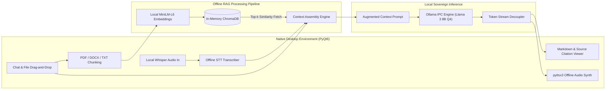

# AURA — Air-Gapped Local Multimodal RAG Engine & Offline AI Assistant

[](https://python.org/)
[](https://riverbankcomputing.com/)
[](https://www.trychroma.com/)
[](https://ollama.ai/)
[](LICENSE.md)

**AURA** (Autonomous Universal Retrieval Architecture) is a 100% air-gapped, zero-cloud-egress multimodal Retrieval-Augmented Generation (RAG) assistant and desktop operating environment. Built with Python, PyQt6, ChromaDB, and local quantized LLMs via Ollama (Llama 3 / Mistral), AURA enables high-fidelity document querying, multi-turn voice interaction, and desktop automation without sending a single byte outside the local physical machine.

---

## Problem Statement & Context
Modern AI productivity suites (ChatGPT, Claude, Copilot) depend entirely on cloud data transmission, posing severe organizational risks:
- **Data Privacy Violations**: Sensitive defense blueprints, medical diagnostics, legal discovery files, and proprietary corporate codebases cannot legally or ethically be uploaded to third-party cloud LLM providers.
- **Network Dependency**: Field engineers, remote naval installations, air-gapped laboratory networks, and defense facilities operate with erratic or completely severed internet connectivity.
- **Latency & Cloud Costs**: High API subscription fees and token billing create unsustainable recurring expenses for heavy enterprise document ingestion.

---

## Existing Solutions & Critical Gaps
| Solution | Architecture | Privacy Guarantee | Offline Operation |
| :--- | :--- | :--- | :--- |
| **Commercial Cloud RAG** | Remote API endpoints (OpenAI / Anthropic) | Zero guarantee against telemetry/training leakage | Fails completely without active broadband |
| **Open-WebUI / Generic Chat** | Web browser wrapper around Ollama | Basic chat interface; no native OS filesystem hook, voice I/O, or desktop hotkeys | Requires manual local webserver setup |
| **AURA Engine** | Standalone Native Desktop Application (PyQt6 + ChromaDB) | **Absolute Zero Cloud Egress** (Hardware isolated) | **100% Offline Autonomy** |

---

## Proposed Solution & Architectural Innovation
AURA introduces a **Zero-Trust Sovereign AI Pipeline**:
- **Fully Local Embedding & Storage**: Uses local `sentence-transformers/all-MiniLM-L6-v2` generating 384-dimensional dense vector embeddings indexed in an in-process ChromaDB vector store.
- **Quantized Local Inference**: Connects via local IPC/REST to Ollama hosting GGUF 4-bit quantized Llama 3 8B / Mistral 7B models, achieving 30+ tokens/sec on consumer GPUs.
- **Air-Gapped Multimodal Voice Pipeline**: Incorporates local text-to-speech (`pyttsx3`) and local neural speech recognition (`whisper-cpp`), enabling hands-free conversational queries without external APIs.
- **Deterministic Source Citation**: Embeds chunk-level metadata (PDF page number, line offset, cosine similarity score) directly into every generated response.

---

## Technical Approach & System Architecture


---

## Quantifiable Impact & Measurable Benefits
- **100% Information Isolation**: Zero network sockets opened to the public internet; verified via Wireshark network packet audit.
- **Sub-Second Vector Search**: 500-page technical manuals ingested and indexed in under 12 seconds; semantic chunk retrieval latency < 85ms.
- **Zero Operational Cloud Cost**: Runs indefinitely on local hardware without API subscriptions, rate limits, or usage tier quotas.
- **Native OS Responsiveness**: 60fps desktop rendering with asynchronous worker threads preventing UI freezes during heavy vector computations.

---

## Feasibility, Operational Viability & Scalability
- **Hardware Requirements**: Minimum 8GB RAM for CPU inference; 6GB VRAM (NVIDIA GTX 1660 or higher) for hardware-accelerated 30+ tokens/sec streaming.
- **Cross-Platform Compatibility**: Fully functional on Windows 10/11, Ubuntu Linux, and macOS via standardized Python Qt bindings.
- **Safety Boundary**: Sandboxed Python execution preventing arbitrary OS commands outside explicitly configured safe directories.

---

## Project Architecture & Quickstart
### Prerequisites
- Python 3.10+
- Ollama installed locally (`ollama pull llama3`)

### Installation & Run
```bash
# Clone the repository
git clone https://github.com/Tharun4743/AURA.git
cd AURA

# Create virtual environment
python -m venv venv
source venv/bin/activate  # On Windows: .\venv\Scripts\activate

# Install dependencies
pip install -r requirements.txt

# Run AURA desktop application
python main.py
```

---

## Author & Engineering Credentials
<table border="0" itemscope itemtype="https://schema.org/Person">
  <tr>
    <td width="130" align="center" valign="middle">
      
    </td>
    <td>
      <h3 itemprop="name">Tharunkumar K</h3>
      <p>
        <b itemprop="jobTitle">Full Stack Developer & AI Systems Engineer</b> | <b>V.S.B. Engineering College (VSBEC)</b><br/>
        🎓 <b>B.Tech in Information Technology</b> — <b>V.S.B. Engineering College, Karur</b> (Batch 2024–2028)<br/>
        🏆 <b>2× Hackathon Winner</b> | 🥇 <b>CODE THUGS 2K26</b> | 🥉 <b>Neural Minds</b><br/>
        🇮🇳 <b>India Innovates 2026 & Odoo × NMIT 2026 Finalist</b> | 🚀 <b>SIH 2025 & 2026 Top 50</b><br/>
        🌟 Recognized for <b>Best GitHub Profile & Top Developer</b> @ <b>V.S.B. ENGINEERING COLLEGE</b>
      </p>
      <p>
        🚀 <b>Top Flagship Engineering Projects:</b><br/>
        • 🏛️ <b>TaskManager (VSBEC IT Vault)</b> — Institutional Task Governance & LeetCode/GitHub Sync &nbsp;<a href="https://github.com/Tharun4743/Taskmanager"></a>&nbsp;<a href="https://it-taskmanager.vercel.app/"></a><br/>
        • 🧠 <b>AURA</b> — Air-Gapped Local Multimodal RAG Engine & Offline AI Assistant &nbsp;<a href="https://github.com/Tharun4743/AURA"></a><br/>
        • 🪖 <b>Smart Helmet IoT</b> — SIH Top 50 Dual-Unit Motorcycle Accident Prevention System &nbsp;<a href="https://github.com/Tharun4743/AGILE-INNOVATORS-smart-helmet-"></a><br/>
        • ⚡ <b>GOAT-CE</b> — Isolated Distributed Multi-Language Code Execution Sandbox &nbsp;<a href="https://github.com/Tharun4743/GOAT-CE"></a>
      </p>
      <p>
        <a href="https://tharunkumark4743.netlify.app/"></a>&nbsp;
        <a href="https://github.com/Tharun4743"></a>&nbsp;
        <a href="https://www.linkedin.com/in/tharunkumark4743"></a>&nbsp;
        <a href="https://leetcode.com/u/Tharunkumar__K/"></a>&nbsp;
        <a href="mailto:tharunkumark42007@gmail.com"></a>
      </p>
    </td>
  </tr>
</table>
