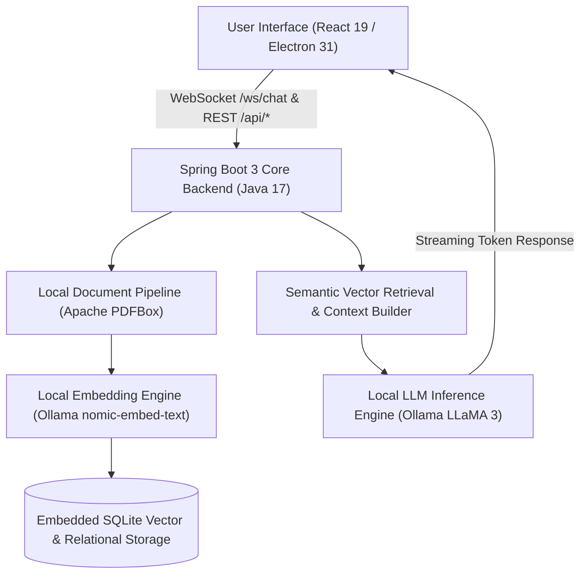

# 🧠 AURA — AI Unified Retrieval Assistant
### *Air-Gapped Local Multimodal RAG Engine & Offline AI Knowledge Assistant for Desktop & Web*

[-000000?style=for-the-badge&logo=ollama&logoColor=white)](#)

  <a href="https://github.com/Tharun4743/AURA">📦 <b>Official GitHub Repository</b></a>

---

## 1. 📌 Problem Statement & Context
Enterprises, defense agencies, legal practices, and healthcare facilities handle confidential internal documents under strict regulatory mandates:
* 🔒 **Data Privacy & Leakage Hazards:** Feeding internal trade secrets, proprietary source code, or patient records to cloud LLM APIs breaches compliance (GDPR, HIPAA, air-gapped policies).
* 💸 **Unpredictable Cloud Costs:** High-volume document indexing incurs steep per-token pricing and recurring API subscription overhead.
* 📴 **Connectivity Dead Zones:** Maritime, defense, remote field, and secure cleanroom facilities operate with zero internet connectivity.

---

## 2. 🔍 Existing Solutions & Critical Gaps
| Knowledge Assistant Metric | Commercial Cloud LLM APIs | Generic Local Python Scripts | 🧠 AURA Local RAG System |
| :--- | :---: | :---: | :---: |
| **100% Air-Gapped Privacy** | ❌ Data Leaves Organization | ⚠️ Complex Setup / Fragile | ✅ Complete Air-Gapped Isolation |
| **Real-Time Token Streaming** | ✅ Paid Cloud WebSockets | ❌ Slow Batch Generation | ✅ High-Throughput Java WebSockets |
| **Verified Page Citations** | ⚠️ Frequent Hallucinations | ❌ Unreliable Scraping | ✅ Deterministic Page-Level Citations |
| **Unified Web & Desktop App** | ⚠️ Web Only | ❌ CLI Only | ✅ Dual React + Electron Distribution |

---

## 3. 💡 Proposed Solution & Architectural Innovation
**AURA (AI Unified Retrieval Assistant)** is an air-gapped, privacy-first local multimodal Retrieval-Augmented Generation (RAG) platform architected by **Tharunkumar K**:
* 🛡️ **100% On-Device Inference:** Executes quantized local LLMs (`llama3`) and dense embeddings (`nomic-embed-text`) entirely on local consumer silicon via Ollama.
* 📄 **Deterministic Document Extraction:** Ingests multi-page PDFs using Apache PDFBox with strict chunk-to-page citation tracking.
* ⚡ **High-Concurrency Spring Boot Backend:** Enterprise Java 17 service tier delivering streaming token responses over bi-directional WebSocket connections (`/ws/chat`).

---

## 4. ⚙️ Technical Approach & System Architecture

### 📐 High-Level Architectural Flowchart:

| Subsystem | Technology Stack | Operational Responsibility |
| :--- | :--- | :--- |
| **Desktop Shell** | Electron 31, Node.js | Cross-platform desktop runtime, system tray, window management, and bundled JRE |
| **Web Frontend** | React 19, Vite, Tailwind CSS | High-performance reactive UI with instant hot reloading and markdown rendering |
| **Backend Core** | Java 17, Spring Boot 3.x | Enterprise REST endpoints, WebSocket streaming controllers, and HikariCP connection pooling |
| **Document Processing**| Apache PDFBox, Commons IO | High-fidelity text extraction, multi-page segmentation, and token boundary chunking |
| **Local AI Inference** | Ollama (`llama3`, `nomic-embed-text`)| On-device dense vector embeddings and streaming local LLM generation |
| **Data Storage** | SQLite JDBC, Hibernate ORM | Zero-configuration local database for chat history and vector indexing |

---

## 5. 📈 Quantifiable Impact & Measurable Benefits
* 🛡️ **100% Zero-Cloud Data Sovereignty:** Zero bytes transmitted externally; completely air-gapped and immune to third-party data interception.
* 💰 **Zero Recurring Token Costs:** Eliminates monthly SaaS fees and per-token cloud API bills.
* ⚡ **Sub-100ms Vector Similarity Matching:** Embedded SQLite vector lookups retrieve relevant context segments instantaneously.
* 🎯 **Elimination of Hallucinations:** Every generated statement links back to exact page numbers in the uploaded source documents.

---

## 6. 🚀 Feasibility, Operational Viability & Scalability
* 🔬 **Technical Feasibility:** Runs smoothly on consumer hardware with 16GB RAM using quantized 4-bit and 8-bit local models.
* 💰 **Economic Viability:** Single-click launcher (`run-web.bat`) eliminates complex orchestration software requirements.
* 📈 **Enterprise Scalability:** Modular Spring Boot microservice architecture readily accommodates additional local embedding and vision models.

---

## 7. 👨‍💻 Engineering Author

<table border="0">
  <tr>
    <td width="120" align="center" valign="top">
      
    </td>
    <td>
      <h3>Tharunkumar K</h3>
      

        <b>Full Stack Developer & AI Systems Engineer</b> 
        🎓 B.Tech in Information Technology — <a href="https://vsbec.com"><b>V.S.B. Engineering College, Karur</b></a> (Batch 2024–2028) 
        🌟 Recognized for holding the <b>Best GitHub Profile & Top Student Developer</b> at V.S.B. Engineering College (VSBEC) 
        🥇 <b>Winner — Code Thugs 2K26</b> • 🚀 <b>Smart India Hackathon (SIH)</b> Top 50 National Finalist
      

      

        <a href="https://tharunkumark4743.netlify.app/">🌐 Portfolio</a> •
        <a href="https://github.com/Tharun4743">🐙 GitHub (@Tharun4743)</a> •
        <a href="https://www.linkedin.com/in/tharunkumark4743">💼 LinkedIn</a> •
        <a href="https://leetcode.com/u/Tharunkumar__K/">🧩 LeetCode</a> •
        <a href="mailto:tharunkumark42007@gmail.com">📧 Email</a>
      

    </td>
  </tr>
</table>

---

## 8. 📜 License & Intellectual Property Notice

> [!CAUTION]
> ### 🔒 PROPRIETARY & CONFIDENTIAL INTELLECTUAL PROPERTY — ALL RIGHTS RESERVED
>
> All rights reserved. This repository, its architecture, source code, workflows, models, and associated documentation are the exclusive intellectual property of **Tharunkumar K™**.
>
> **STRICT NOTICE:** No individual, organization, institution, or commercial entity is permitted to use, copy, modify, distribute, reproduce, sublicense, reverse-engineer, deploy, or commercially exploit any portion of this project without express, prior written permission from **Tharunkumar K**.
>
> **Copyright © 2026 Tharunkumar K. All Rights Reserved.**  
> See the [`LICENSE`](LICENSE) file for complete legal terms.

<!-- =========================================================================
   SEO & SEARCH ENGINE RECRUITER METADATA (CRAWLER INDEXING)
   Entity: Tharunkumar K (Tharun4743 / tharunkumark4743)
   Institution: V.S.B. Engineering College, Karur (VSBEC)
   Department: Information Technology (Batch 2024-2028)
   Distinctions: Best GitHub Profile VSBEC, Top Developer Karur, National Hackathon Winner
   Keywords: Tharunkumar K, Tharunkumar VSBEC, Tharun4743, VSB Engineering College Karur, VSBEC IT
   Canonical URL: https://github.com/Tharun4743/AURA
========================================================================= -->